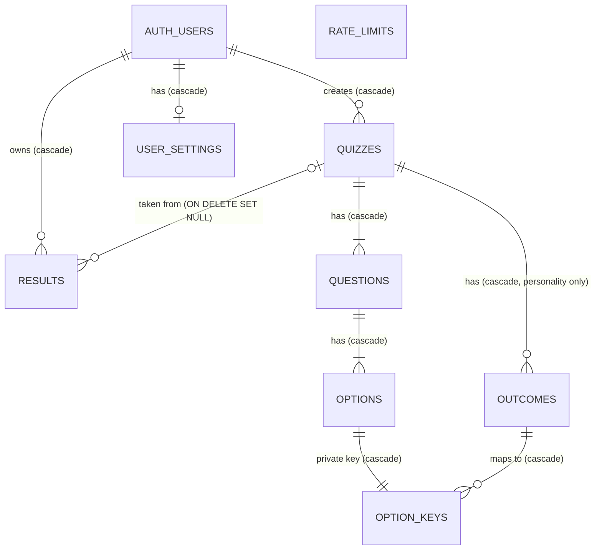
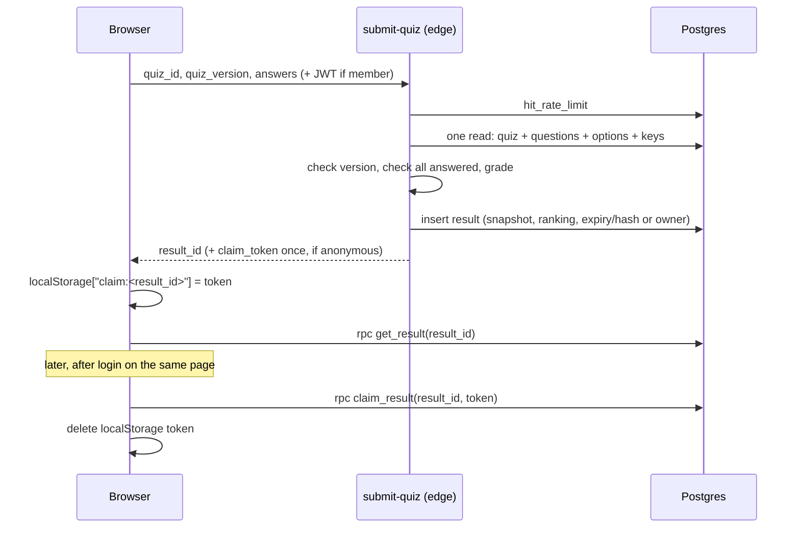

# Architecture Spec: Domain Model and Database

Status: **Draft** (2026-11-06). Written for whoever writes the spec for feature 0 (project foundation) and the features after it.

## 1. How to use this document

- `CLAUDE.md` is the source of truth. If this document disagrees with it, `CLAUDE.md` wins. Fix this document instead of working around it.
- This document turns the rules in `CLAUDE.md` into a concrete domain model, schema, access layer, and server-logic map. It does not replace feature specs. Each feature still needs its own spec with acceptance criteria.
- Everything marked **(call)** is a design choice made while drafting this document, not something the project owner decided. All of them are collected in section 15 for review. Change any of them before the feature that builds it starts.
- Open decisions from `CLAUDE.md` §13 stay open (section 14). This document leaves room for them and does not decide them.

## 2. Design principles

"Modern and scalable" here means Postgres and Supabase patterns that stay correct and fast as data grows. It does **not** mean extra infrastructure. `CLAUDE.md` asks for clear and boring over clever, so there is no event sourcing, CQRS, message queue, cache layer, microservice, or new library.

1. **The database is the source of truth.** Constraints, foreign keys, unique indexes, and check constraints enforce the rules. App code and Zod repeat them for good error messages, but the database is the last line.
2. **Deny by default.** RLS is on for every table. Every table and function starts with all privileges revoked from `anon` and `authenticated`, and each grant is then added on purpose. Do not rely on Supabase's default grants.
3. **Row rules in RLS, column rules in grants or separate tables.** Answer keys live in their own table. Creator IDs are hidden with column grants and a view.
4. **Writes that must be atomic happen in one SQL statement or one database function.** No read-then-write races from the client or edge functions.
5. **Results are immutable snapshots.** A result never reads live quiz rows after it is created.
6. **The database cleans up after itself.** Foreign key cascades handle account deletion. `pg_cron` handles expiry. App code never runs cleanup loops.
7. **Secrets stay server-side.** The service role key, the IP-hash salt, and answer keys never reach the browser.

## 3. Domain model

### 3.1 Glossary

| Term | Meaning |
| --- | --- |
| **Anonymous visitor** | Someone not logged in. Can take quizzes. Their results expire after 1 day. |
| **Member** | A logged-in user (Supabase Auth, email one-time code). Owns results long term, creates quizzes, has settings. |
| **Creator** | The member who created a quiz. Not a separate role, just the quiz's owner. |
| **Quiz** | A public set of questions. Its **kind** is `trivia` or `personality`. "Test" is only a word in a title, never a kind. |
| **Question** | One item in a quiz. **Type** is `single_choice`, `true_false`, or `multi_select`. Personality quizzes use `single_choice` only. |
| **Option** | One answer choice in a question. The only way a taker answers. There are no free-text answers. |
| **Outcome** | A possible result of a personality quiz, such as "You are a night owl." Titles and descriptions are public. |
| **Answer key** | The private part of each option: whether it is correct (trivia), or which outcome it maps to and for how many points (personality). Stored in `option_keys`. |
| **Quiz version** | An integer on the quiz that goes up on every edit. Used to reject submissions for a quiz that changed. |
| **Take** | One person working through a quiz in the browser. It exists only in session storage (answers and timer start) and never on the server. |
| **Submission** | A take sent to the `submit-quiz` edge function: quiz ID, the version loaded, and the selected option IDs per question. |
| **Result** | The stored, graded outcome of a submission, with an unguessable ID. Viewed at a result link. |
| **Result snapshot** | The copy of the quiz (questions, options, answer key, scoring) and the taker's answers stored on the result. |
| **Outcome ranking** | For personality results, every outcome ordered by points, with ties already shuffled at submission. Stored once and never recomputed. |
| **Claim token** | A random secret returned once for an anonymous result. Only its hash is stored. Lets a member save that result to their account from the same browser. |
| **Claiming** | A member explicitly saving an unexpired, unowned anonymous result to their account. |
| **Settings** | A member's theme and accessibility preferences, one row per member. |
| **Rate-limit bucket** | A short-lived counter of actions per subject (salted IP hash or user ID) per time window. |

### 3.2 Entity relationships



`RATE_LIMITS` has no foreign keys on purpose. Its subject is a hash or an ID stored as text, and its rows are deleted by time, not by owner.

### 3.3 Lifecycles

**Quiz:** created by a member through `save_quiz` (version 1) → edited through `save_quiz` (version +1 each time, child rows replaced) → deleted by its creator, or by the cascade when the creator deletes their account. Existing results are never touched. Their `quiz_id` becomes `NULL`.

**Result:**

```
member submits        ─▶ owned (no expiry) ─────────────────────▶ deleted only with the account
anonymous submits     ─▶ unowned, expires_at = now + 1 day, claim_token_hash set
                          ├─ member claims with token (before expiry) ─▶ owned (no expiry)
                          └─ expires ─▶ reads return "expired" ─▶ cron deletes row (within 15 min)
```

## 4. Schema

All tables live in the `public` schema. All IDs are `uuid default gen_random_uuid()`, which is UUIDv4. All times are `timestamptz`.

**(call) UUIDv4, not UUIDv7.** UUIDv7 is the modern choice for index locality, but it puts a timestamp in the ID and has about 74 random bits instead of 122. Result IDs must be unguessable, so use v4 everywhere and keep one ID style.

### 4.1 Enum types

```sql
create type quiz_kind      as enum ('trivia', 'personality');
create type question_type  as enum ('single_choice', 'true_false', 'multi_select');
create type rate_limit_scope as enum ('anon_submit', 'member_submit', 'quiz_create');
create type theme_pref     as enum ('system', 'light', 'dark');
create type contrast_pref  as enum ('system', 'on', 'off');  -- (call) values
```

### 4.2 `quizzes`

| Column | Type | Notes |
| --- | --- | --- |
| `id` | `uuid` PK | |
| `creator_id` | `uuid not null` → `auth.users(id) on delete cascade` | Hidden from the public (section 6). |
| `kind` | `quiz_kind not null` | Cannot change after creation **(call)**, so a quiz never switches scoring rules. |
| `title` | `text not null` | Length limit set in feature 2's spec. |
| `normalized_title` | `text generated always as (lower(btrim(regexp_replace(title, '\s+', ' ', 'g')))) stored` | For the unique-title rule. Collapses all whitespace (tabs and newlines too) to single spaces first, then trims, then lowercases. |
| `description` | `text not null default ''` | Length limit set in feature 2's spec. |
| `suggested_time_seconds` | `int null`, `check (> 0)` | Null means no timer (`CLAUDE.md` §9). |
| `version` | `int not null default 1` | Increased by `save_quiz` on every edit. |
| `search` | `tsvector generated always as (setweight(to_tsvector('english', title), 'A') \|\| setweight(to_tsvector('english', description), 'B')) stored` | **(call)** English dictionary. Title outranks description. |
| `created_at`, `updated_at` | `timestamptz not null default now()` | `updated_at` set by `save_quiz`. |

Indexes:

- `unique (creator_id, normalized_title)`: one title per creator. Different creators may share titles.
- `gin (search)`: full-text search.
- `(creator_id, created_at desc)`: the creator's dashboard list. Also serves the FK cascade on account deletion.

### 4.3 `questions`, `options`, `outcomes`

| Table | Columns |
| --- | --- |
| `questions` | `id`, `quiz_id → quizzes on delete cascade`, `position int not null`, `type question_type not null`, `prompt text not null`. `unique (quiz_id, position)`. |
| `options` | `id`, `question_id → questions on delete cascade`, `position int not null`, `label text not null`. `unique (question_id, position)`. |
| `outcomes` | `id`, `quiz_id → quizzes on delete cascade`, `position int not null`, `title text not null`, `description text not null default ''`. `unique (quiz_id, position)`. |

These hold nothing secret. Anyone can read them so they can take the quiz.

### 4.4 `option_keys` (private answer key)

| Column | Type | Notes |
| --- | --- | --- |
| `option_id` | `uuid` PK → `options(id) on delete cascade` | One key per option. |
| `is_correct` | `boolean null` | Trivia only. |
| `outcome_id` | `uuid null` → `outcomes(id) on delete cascade` | Personality only. |
| `points` | `int null`, `check (points > 0)` | Personality only. Defaults to 1 in the form. |

Check constraint, so each row is clearly one shape or the other:

```sql
check (
  (is_correct is not null and outcome_id is null and points is null) or
  (is_correct is null and outcome_id is not null and points is not null)
)
```

Index `(outcome_id)` for the cascade.

Rules that need other tables (such as "the outcome belongs to the same quiz" or "the key shape matches the quiz kind") are checked in `save_quiz` (section 7.1). That is the only write path.

### 4.5 `results`

| Column | Type | Notes |
| --- | --- | --- |
| `id` | `uuid` PK | Unguessable. This is the result link. |
| `owner_id` | `uuid null` → `auth.users(id) on delete cascade` | Null means anonymous. |
| `quiz_id` | `uuid null` → `quizzes(id) on delete set null` | Never cascades. Null means the quiz no longer exists. |
| `quiz_version` | `int not null` | The version that was graded. |
| `quiz_kind` | `quiz_kind not null` | |
| `quiz_title` | `text not null` | **(call)** Copied out of the snapshot so the dashboard list does not have to load whole snapshots. |
| `snapshot` | `jsonb not null` | Section 5. |
| `score` | `numeric(5,4) null`, `check (score between 0 and 1)` | Trivia only. Uses `numeric` so partial credit does not drift. |
| `outcome_ranking` | `jsonb null` | Personality only. Section 5. |
| `expires_at` | `timestamptz null` | Set only for anonymous results. |
| `claim_token_hash` | `text null` | Lowercase hex SHA-256 of the claim token string's UTF-8 bytes (section 7.2 step 8). Anonymous only. |
| `created_at` | `timestamptz not null default now()` | |

Check constraints:

```sql
-- owned results never expire and have no token; anonymous results always do
check (
  (owner_id is not null and expires_at is null and claim_token_hash is null) or
  (owner_id is null and expires_at is not null and claim_token_hash is not null)
),
check ((quiz_kind = 'trivia') = (score is not null)),
check ((quiz_kind = 'personality') = (outcome_ranking is not null))
```

Indexes:

- `(owner_id, created_at desc, id)`: the member's dashboard history with keyset pagination.
- `(quiz_id)`: **required.** Without it, deleting a quiz runs `ON DELETE SET NULL` as a full scan of `results`.
- `(expires_at) where owner_id is null`: a partial index for the cleanup job and expiry checks.

### 4.6 `user_settings` (built in feature 5)

| Column | Type | Notes |
| --- | --- | --- |
| `user_id` | `uuid` PK → `auth.users(id) on delete cascade` | |
| `theme` | `theme_pref not null default 'system'` | |
| `text_size` | `text not null`, with a check constraint | Allowed values set in feature 5's spec and mirrored by Zod. |
| `high_contrast` | `contrast_pref not null default 'system'` | `system` follows `prefers-contrast`. |
| `dyslexia_font` | `boolean not null default false` | |
| `updated_at` | `timestamptz not null default now()` | |

### 4.7 `rate_limits` (built in features 1 and 2)

| Column | Type | Notes |
| --- | --- | --- |
| `scope` | `rate_limit_scope not null` | |
| `subject` | `text not null` | `anon_submit`: hex HMAC-SHA256 of the IP with a server-side salt. Other scopes: the user ID. |
| `window_start` | `timestamptz not null` | Fixed window, `date_bin(window, now(), 'epoch')`. |
| `window_ends_at` | `timestamptz not null` | Lets cleanup delete rows without knowing each scope's window. |
| `count` | `int not null` | The first hit inserts `1`. Later hits in the same window increment it. |

PK `(scope, subject, window_start)`. Index `(window_ends_at)` for cleanup. **(call)** Fixed windows, the simplest correct limiter. A sliding window is not needed for spam protection.

### 4.8 Limits

Maximum text lengths and maximum numbers of questions and options are set in feature 2's spec. Add them as `check (char_length(...) <= n)` constraints in the same migration as the Zod schema, so the two never drift apart.

## 5. Result snapshot format

The snapshot holds everything a result page needs, so it never reads the live quiz. It carries a `snapshot_version` so the format can change later without breaking old rows.

```jsonc
{
  "snapshot_version": 1,
  "quiz": {
    "id": "uuid", "title": "…", "description": "…",
    "kind": "trivia", "version": 3, "suggested_time_seconds": 600
  },
  "outcomes": [            // personality only, [] for trivia
    { "id": "uuid", "title": "…", "description": "…" }
  ],
  "questions": [
    {
      "id": "uuid", "position": 1, "type": "multi_select", "prompt": "…",
      "options": [
        { "id": "uuid", "label": "…", "is_correct": true },          // trivia
        { "id": "uuid", "label": "…", "outcome_id": "uuid", "points": 2 } // personality
      ],
      "selected_option_ids": ["uuid"],
      "score": 0.5          // trivia only, 0 to 1
    }
  ]
}
```

`outcome_ranking` (its own column) is an ordered array, highest first, with ties already in their random order:

```json
[{ "outcome_id": "uuid", "points": 7 }, { "outcome_id": "uuid", "points": 7 }, { "outcome_id": "uuid", "points": 2 }]
```

The winning outcome is `outcome_ranking[0]`. Result pages read it and never re-sort or re-randomize it. Stretch goal S5 (top N outcomes) will only need to read more of the same array.

**Scoring stored in the snapshot (from `CLAUDE.md` §1):**

- Single-choice and true/false: 1 if the correct option is selected, else 0.
- Multi-select: `max(0, (correct selected − wrong selected) / number of correct options)`.
- Quiz score: the sum of question scores divided by the number of questions.

**What the result page sees.** The stored snapshot always holds the full answer key, so a result is self-contained. What leaves the database through `get_result` depends on the kind:

- **Trivia:** the full snapshot, including `is_correct`. Anyone can then learn the answers by submitting once, which `CLAUDE.md` §1 accepts deliberately.
- **Personality:** `get_result` strips `outcome_id` and `points` from every option before returning it. `CLAUDE.md` §6 says only grading functions and the creator can read outcome mappings, and §1's "deliberate choice" only covers trivia. `outcome_ranking` is not returned either. In version 1, the result page shows only the **winning outcome** (its title and description), with no point totals and no other outcomes (`CLAUDE.md` §1). `get_result` returns just the winning outcome. The full ranking stays stored for stretch goal S5.

## 6. Access layer: privileges, RLS, and views

### 6.1 Pattern

Every migration that creates a table does this, in this order:

```sql
alter table x enable row level security;
revoke all on table x from anon, authenticated;
grant select (col_a, col_b) on table x to anon, authenticated;  -- only what is needed
create policy ... ;                                              -- only what is needed
```

A grant without a matching policy returns no rows, and a policy without a grant raises "permission denied". Each access in section 6.2 needs both. For example, public quiz reads need `create policy "public read" on quizzes for select to anon, authenticated using (true)`, and the same for `questions`, `options`, and `outcomes`. Creator deletes need `grant delete on quizzes to authenticated` plus a delete policy. Views get the same revoke-then-grant treatment.

Policy expressions can use columns the caller has no grant on. For example, the delete policy on `quizzes` can filter on `creator_id` even though `authenticated` cannot select it.

Every function does this:

```sql
create function ... security definer set search_path = '' as $$ ... $$;
revoke execute on function ... from public, anon, authenticated;
grant execute on function ... to <the roles that need it>;
```

In policies, write `(select auth.uid())` instead of `auth.uid()`. Postgres then evaluates it once per query instead of once per row, which is Supabase's own RLS performance advice. Every column a policy filters on is indexed.

### 6.2 Access matrix

`R` = select, `I` = insert, `U` = update, `D` = delete. "fn" means only through a function.

| Table | anon | authenticated | service_role (edge functions) |
| --- | --- | --- | --- |
| `quizzes` | R (all columns except `creator_id`) | R (same columns). D own rows (`creator_id = (select auth.uid())`). I/U through `save_quiz` only. | full |
| `questions`, `options`, `outcomes` | R | R. Writes through `save_quiz` only. | full |
| `option_keys` | none | none directly. Own quizzes' keys through `get_quiz_for_edit`. | full (grading) |
| `results` | none. One row by exact ID through `get_result`. | R own rows (`owner_id = (select auth.uid())`), all columns except `claim_token_hash`. Others by exact ID through `get_result`. Claim through `claim_result`. **No I/U/D policy for any client role.** | I and R only (submit). `delete` revoked. |
| `user_settings` | none | R/I/U own row (`user_id = (select auth.uid())`). No D (cascades with the account). | full |
| `rate_limits` | none | none | through `hit_rate_limit` |

No role ever gets a delete policy on `results`, matching `CLAUDE.md` §1. `delete` on `results` is also revoked from `service_role`, so no edge function can delete a result. Rows leave only through two paths. The `auth.users` cascade runs as part of the account deletion. The `pg_cron` job runs as `postgres`, which owns the tables and is not subject to these grants.

### 6.3 Hiding the creator ID

RLS cannot hide a column, so `creator_id` is hidden with column grants (section 6.1). `select *` fails under column grants, which is awkward with supabase-js, so the app reads quizzes through a view:

```sql
create view quizzes_public with (security_invoker = true) as
select q.id, q.kind, q.title, q.description, q.suggested_time_seconds,
       q.version, q.created_at, q.updated_at, q.search,
       (select count(*) from public.questions where quiz_id = q.id) as question_count
from public.quizzes q;
```

`security_invoker = true` means the caller's grants and RLS still apply. The view is for convenience only. The column grant is what enforces the rule. The granted columns therefore include `search`, so `search_quizzes` can run against the view.

Creators see their own quizzes "in full" through two functions instead of extra grants: `list_my_quizzes()` and `get_quiz_for_edit(quiz_id)` (section 7.1). **(call)** This avoids a second, security-definer view, which Supabase's linter flags.

## 7. Server logic map

`CLAUDE.md` §6 decides where logic lives: edge functions for anything needing secrets, request headers, or the service role key, and database functions for short atomic operations.

### 7.1 Database functions

All are `security definer`, `set search_path = ''`, with execute granted only where listed.

| Function | Callable by | What it does |
| --- | --- | --- |
| `get_result(p_id uuid) returns jsonb` | anon, authenticated | Looks up one row by exact ID. Returns `{status: 'ok' \| 'expired' \| 'not_found', result?, quiz_exists, quiz_updated, claimable}`. `quiz_updated` is true when the quiz still exists and its current `version` is higher than the result's `quiz_version`. The result page then shows a short notice, "This quiz has been updated since this result was saved", with a link to take the current version. Checks `expires_at > now()` on every read and does not rely on cleanup. For personality results, it strips outcome mappings from the snapshot (section 5). Once cleanup has deleted an expired row, it returns `not_found`, so the not-found message reads "This result doesn't exist or has expired. Anonymous results are kept for 1 day." Never returns `owner_id`, `claim_token_hash`, or any account identifier. `quiz_exists` is `quiz_id is not null`. `claimable` is `owner_id is null and not expired`. The browser shows "Save to my account" only if it is also signed in and holds the token. |
| `claim_result(p_id uuid, p_token text) returns boolean` | authenticated | One statement: `update results set owner_id = (select auth.uid()), expires_at = null, claim_token_hash = null where id = p_id and owner_id is null and expires_at > now() and claim_token_hash = encode(sha256(convert_to(p_token, 'UTF8')), 'hex') returning id`. This uses Postgres's built-in `sha256()`, so pgcrypto is not needed. Returns false if no row matched. Atomic, with no read-then-write race. Raises an error if `auth.uid()` is null. |
| `save_quiz(p_quiz jsonb) returns jsonb` | authenticated | Creates (no `id`) or edits (with `id` and `expected_version`) a quiz in one transaction. Returns `{id, version}`. See the full rules below. |
| `get_quiz_for_edit(p_id uuid) returns jsonb` | authenticated | Returns the full quiz, including answer keys, only if the caller is the creator. |
| `list_my_quizzes(p_after …) returns setof …` | authenticated | The caller's quizzes, keyset-paginated, for the dashboard. |
| `search_quizzes(p_query text, …) returns setof …` | anon, authenticated | **security invoker** (no extra rights needed). Full-text search over `quizzes_public` (section 9). |
| `hit_rate_limit(p_scope, p_subject, p_max int, p_window interval) returns boolean` | service_role, and internally by `save_quiz` | Atomic upsert: `insert … (count) values (1) on conflict (scope, subject, window_start) do update set count = rate_limits.count + 1 returning count`. Returns `count <= p_max`. |

**`save_quiz` in detail.** Every failure raises an exception, so the whole transaction rolls back, including any rate-limit increment. Failed saves therefore never count toward the creation limit. Errors use `raise exception ... using errcode = 'P0001'` with a stable `message` code (and `detail` where noted), which supabase-js surfaces to the form.

1. The caller must be authenticated. On edit, the caller must be the quiz's creator, `expected_version` must equal `version` (otherwise `stale_version`), and `kind` must not change.
2. Validate every rule in `CLAUDE.md` §1:
   - at least 3 questions
   - single-choice: at least 2 options, exactly 1 correct
   - true/false: exactly 2 options labelled `True` and `False`, exactly 1 correct
   - multi-select: at least 2 options, at least 1 correct, at least 1 incorrect
   - personality quizzes: single-choice questions only, at least 2 outcomes, every option mapped to exactly 1 outcome of **this** quiz with whole-number points greater than 0, and every outcome reachable from at least 1 option
   - the answer-key shape matches the kind (trivia keys use `is_correct`, personality keys use `outcome_id` and `points`)
   - text and count limits from feature 2's spec
3. On create only, call `hit_rate_limit('quiz_create', caller_id, …)`. If it returns false, raise `rate_limited`.
4. Write the rows. On edit, delete the questions (which cascades to options and keys) and the outcomes, insert the new ones, and set `version = version + 1, updated_at = now()`.
5. Catch `unique_violation` on the title index in a nested `begin … exception` block. Look up the creator's existing quiz with that normalized title, then raise `duplicate_title` with its ID in `detail`, so the form can link to it.

Quiz deletion uses the RLS delete policy directly (section 6.2) rather than a function. That is the simplest path, and the cascades and `SET NULL` do the rest.

### 7.2 Edge functions

**`submit-quiz`** (feature 1). It must accept both anonymous and logged-in callers. Set its JWT verification according to current Supabase docs for the key type in use. Steps:

1. Parse the body with Zod: `{ quiz_id, quiz_version, answers: { [question_id]: option_id[] } }`.
2. Identify the caller. Verify any user token with Supabase Auth (`getUser` or `getClaims`, whichever current docs recommend), never by decoding it yourself. With no user token, the submission is anonymous. **(call)** A user token that is invalid or expired returns `401` instead of falling back to anonymous, so a member never silently gets an expiring, unowned result. The client refreshes the session and retries.
3. Rate limit before anything else. **(call)** Every accepted request counts, including ones later rejected with 409, 410 or 422. The limit is for stopping spam, and a counter that only counts successes is easier to flood with bad requests. Anonymous: subject = HMAC-SHA256(secret salt, client IP). The header holding the real IP must be confirmed from current Supabase docs and recorded in feature 1's spec. Never log or store the raw IP. Member: subject = user ID. Over the limit returns `429`.
4. Load the quiz, its questions, options, outcomes, and `option_keys` in **one** PostgREST request with embedded resources. One request is one SQL statement, so it sees a consistent copy of the quiz even if `save_quiz` runs at the same moment.
5. No quiz returns `410 quiz_deleted`. A version other than `quiz_version` returns `409 quiz_changed` with the current version.
6. Any unanswered question (a multi-select needs at least 1 selection) returns `422 unanswered` with the question IDs. These return `422 invalid_answers`:
   - an answer for a question that is not in this quiz
   - an option ID that does not belong to its question
   - a duplicate option ID
   - more than 1 selection on a single-choice or true/false question
7. Grade (section 5). For personality quizzes, total points per outcome, sort, and shuffle each group of tied outcomes using `crypto.getRandomValues`.
8. Build the snapshot and insert the result with the service role. Member: `owner_id` set, no expiry, no token. Anonymous: generate a token (32 random bytes, encoded as a base64url string), and store `expires_at = now() + interval '1 day'` and the lowercase hex SHA-256 of **the base64url string's UTF-8 bytes** (Web Crypto `crypto.subtle.digest('SHA-256', new TextEncoder().encode(token))`). This matches `claim_result` exactly. If the quiz was deleted after step 4, the insert fails its foreign key (`23503`). Return `410 quiz_deleted` in that case.
9. Return `200 { result_id, claim_token? }`. The claim token appears in this response once and never anywhere else. It is never logged.

**`delete-account`** (feature 5). Verify the caller's JWT, then call `auth.admin.deleteUser(user_id)` with the service role. The foreign keys delete their quizzes (and child rows and keys), their results, and their settings. Other people's results keep their snapshots, and their `quiz_id` becomes null. Member `rate_limits` rows are not linked and expire with their window.

### 7.3 Scheduled cleanup (`pg_cron`, every 15 minutes)

Defined in a migration that first enables the `pg_cron` extension the way current Supabase docs show. The job runs as `postgres`, the table owner, so RLS and the client grants do not block it.

```sql
select cron.schedule('cleanup-expired', '*/15 * * * *', $$
  delete from public.results     where owner_id is null and expires_at <= now();
  delete from public.rate_limits where window_ends_at <= now();
$$);
```

Both deletes use the indexes from section 4. No row outlives its expiry or window by more than 15 minutes.

### 7.4 Submit, view, and claim flow



## 8. Concurrency and integrity

- **Optimistic concurrency on quizzes.** `version` is the guard. Takers send the version they loaded and `submit-quiz` rejects a mismatch. Editors send `expected_version` and `save_quiz` rejects a mismatch. No locks and no stored old versions.
- **Consistent reads for grading.** The quiz and its keys are loaded in a single statement (section 7.2 step 4), and `save_quiz` replaces child rows in one transaction, so grading never sees half an edit.
- **Atomic claim.** A single conditional `UPDATE` (section 7.1). Two simultaneous claims cannot both succeed.
- **Uniqueness in the database.** The title rule is a unique index on a generated column, not an app-side check that can race.
- **Valid states are constraints.** "Owned xor expiring" and "trivia has a score, personality has a ranking" are check constraints (section 4.5), so an invalid result cannot be stored.
- **Validation in two places.** Zod in the browser for messages, and `save_quiz` and `submit-quiz` on the server for enforcement. Shared limits live in one migration and one Zod file, side by side.

## 9. Query and scaling patterns

- **Search.** `websearch_to_tsquery('english', p_query)` against the GIN-indexed `search` column, ranked with `ts_rank`. How many words must match and how results are ranked are **open decisions** for feature 6's spec. One way to require "enough" words is to build an OR query and filter on a minimum count of matched lexemes. Feature 6's spec chooses.
- **Keyset pagination, not OFFSET.** Dashboard lists page by `(created_at desc, id)`. Search pages by `(rank desc, id)` for a fixed query. OFFSET gets slower the further you page, and keyset does not.
- **Narrow selects.** The dashboard selects `id, quiz_title, quiz_kind, score, created_at`, not `snapshot`. Only the result page loads the snapshot.
- **Indexes for every foreign key** used by a cascade or `SET NULL`, and for every RLS filter column (section 4).
- **Generated columns** (`normalized_title`, `search`) keep derived data correct without triggers.
- **No connection pooling concerns in app code.** The browser and edge functions talk to Postgres through Supabase's HTTP API (PostgREST), which handles pooling.
- **Snapshot size.** One snapshot is a few KB. Postgres compresses large `jsonb` values automatically (TOAST), so this scales without extra work.

## 10. Client data architecture (how the browser meets the database)

- **Server state: TanStack Query.** Query keys **(call)**: `['quizzes', 'search', query]`, `['quiz', quizId]`, `['result', resultId]`, `['me', 'results']`, `['me', 'quizzes']`, `['me', 'settings']`. Invalidate `['me', …]` on login, logout, and claim.
- **Take progress: Zustand persist in session storage.** One entry per quiz and version, key `take:<quizId>:<version>`, holding the selected option IDs, whether the timer is on, and `timerStartedAt`. An entry for an older version is discarded. Submitting clears it. It is never sent to the server except as the submission itself.
- **Claim tokens: local storage.** Key `claim:<resultId>`, value `{ token, expiresAt }`. Delete it after a successful claim, and prune entries whose `expiresAt` has passed on app start.
- **Settings:** local storage for everyone, applied before first paint, and synced with `user_settings` for members as `CLAUDE.md` feature 5 describes.
- **Types:** database row types come only from the generated `src/types/database.types.ts`. Zod schemas in `src/schemas/` cover forms, the `save_quiz` payload, the submission body, and the snapshot shape read on result pages.

## 11. Migrations and feature sequencing

Create each migration with `supabase migration new <name>`, one concern per file. Every migration that adds a table also adds its grants, RLS, and policies. Regenerate `database.types.ts` after each one.

| Feature | Migrations it adds |
| --- | --- |
| 0. Foundation | enums; `quizzes`, `questions`, `options`, `outcomes`, `option_keys`; `results`; `quizzes_public`; grants and RLS for these; `get_result`; seed quizzes in `seed.sql`. `quizzes.creator_id` must point at a real user, so `seed.sql` first inserts one or two fixed-UUID test users into `auth.users` (local stack only). |
| 4. Authentication | No tables. Login email template in `supabase/templates/`. |
| 6. Search | `search_quizzes`. |
| 2. Creation | `rate_limits`, `hit_rate_limit`; `save_quiz`, `get_quiz_for_edit`; length and count limit constraints. |
| 1. Taking | `submit-quiz` edge function; `pg_cron` cleanup job. |
| 3. Dashboard | `claim_result`, `list_my_quizzes`. |
| 5. Settings | `user_settings`; `delete-account` edge function. |

**(call)** `rate_limits` is built in feature 2 because creation comes before taking in the build order, and both use it. Schema in feature 0 is limited to quizzes and results, as `CLAUDE.md` says.

## 12. Database tests (pgTAP, `supabase/tests/`)

At minimum:

- RLS is enabled on every table in `public`.
- `anon` cannot select from `results`, `option_keys`, or `quizzes.creator_id`.
- A member can select only their own `results` rows, and cannot read `claim_token_hash`.
- No client role can insert, update, or delete `results`, and `service_role` cannot delete them.
- `get_result`: returns `ok`, returns `expired` past `expires_at` even before cleanup, returns `not_found` for an unknown ID, never includes `owner_id`, and strips outcome mappings from personality snapshots.
- `normalized_title` treats `"Capitals Quiz"`, `"capitals  quiz "`, and a tab-separated variant as equal.
- `claim_result`: succeeds once, fails on a second try, fails with a wrong token, fails when expired, fails when already owned, and fails for `anon`.
- Deleting a quiz sets `results.quiz_id` to null and leaves the result intact.
- Deleting an auth user removes their quizzes, results, and settings, and leaves other people's results.
- `save_quiz` rejects each validation rule in `CLAUDE.md` §1, duplicate normalized titles, a stale `expected_version`, and an edit by a non-creator.
- The `results` check constraints reject owned-with-expiry and anonymous-without-token rows.

## 13. Privacy and security checklist

- [ ] No raw IP is stored, logged, or read in the browser. Only an HMAC with a server-side salt.
- [ ] The claim token is never in a URL or a log, and only its hash is stored.
- [ ] The service role key and the salt exist only as edge function secrets.
- [ ] Answer keys are never sent before grading. `option_keys` has no client grants.
- [ ] Result responses contain no email, user ID, or other account identifier.
- [ ] Rate-limit rows are used only for rate limiting and are deleted within 15 minutes of their window ending.
- [ ] No analytics, telemetry, or third-party scripts.

## 14. Open decisions (from `CLAUDE.md` §13, not decided here)

- Rate-limit numbers and window lengths for anonymous submissions, member submissions, and quiz creation. `hit_rate_limit` takes them as parameters.
- The URL mechanism for the quiz details popup (proposed in feature 6's spec). It does not affect the schema.
- Search threshold and ranking.
- Login code length and expiry (Supabase defaults unless changed).
- Also left to feature specs: text and count limits (feature 2), allowed `text_size` values (feature 5), and which header holds the real client IP (feature 1).

## 15. Calls made in this document

Review these. Each one can be changed before its feature starts.

**Confirmed by the project owner (2026-11-06):** calls 2, 3, 6, 8, 15, and 16. Also decided in that review:
- A result for a quiz that has since been edited shows an "updated since" notice (7.1).
- Creators can take and save results for their own quizzes like anyone else, with no special case.
- Domain terms are fixed in `GLOSSARY.md`: Take → Submission → Result, Outcome is never called a "result", Member is used instead of "user", and Suggested time is used instead of "time limit".
- Personality results show only the winning outcome in version 1 (5).
- Snapshots and the private answer-key table are recorded as ADRs 0001 and 0002 in `docs/adr/`.
- After cleanup, expired and unknown results share one message that mentions the 1-day limit (call 17, confirmed).
- **Known limitation, accepted:** the right to claim belongs to the browser holding the claim token, not to a person. On a shared browser, a different member who logs in later can claim an anonymous result left there. Preventing this would mean tying anonymous visitors to an identity, which the site avoids.
- **Left to feature specs:** calls 1, 5, 7, 9, 10, 11, 12, 13, 14, 18, and 19 are technical and easy to change. Each feature's spec may confirm or change them without asking the project owner again.
- **Deferred to the build phase (feature 3):** whether the dashboard's history list flags results whose quiz has since been edited or deleted.

1. UUIDv4 for all IDs, not UUIDv7 (section 4).
2. Quiz `kind` cannot change after creation (4.2).
3. English text-search dictionary, with title weighted above description (4.2). Non-English quizzes still match on exact words but lose stemming. `simple` would treat every language the same.
4. A separate `option_keys` table for the answer key (4.4), with no client grants. Creators read it through `get_quiz_for_edit` (6.3).
5. `quiz_title` copied onto `results` for cheap dashboard lists (4.5).
6. `contrast_pref` values `system`, `on`, `off`, with `system` following `prefers-contrast` (4.1).
7. Fixed-window rate limiting with an atomic upsert (4.7, 7.1).
8. `get_result` hides personality outcome mappings and shows trivia answers, following `CLAUDE.md` §1 and §6 (5).
9. Column grants plus a `security_invoker` view to hide `creator_id`, and functions instead of a definer view for the creator's own data (6.3).
10. `save_quiz` takes `expected_version` to stop two tabs overwriting each other's edits (7.1).
11. Failed quiz saves roll back and never count toward the creation limit (7.1).
12. Quiz deletion through an RLS delete policy, not a function (7.1).
13. Claim token: 32 random bytes as base64url, stored as hex SHA-256 of the string with no salt (high-entropy tokens do not need one) (7.2).
14. Specific HTTP status codes for `submit-quiz` errors: 401, 409, 410, 422, 429 (7.2).
15. An invalid or expired member token gets `401`, never a quiet anonymous result (7.2).
16. Every submission that reaches the limiter counts, including rejected ones (7.2).
17. Once a row has been deleted, expired and unknown results share the message "doesn't exist or has expired" (7.1).
18. TanStack Query key names and local storage key names (10).
19. `rate_limits` built in feature 2, not feature 1 (11).

## 16. Out of scope

Stretch goals S1 to S6 are not modelled, and nothing here prepares for them (`CLAUDE.md` §12). The per-day play-count table for S4 is deliberately absent. `outcome_ranking` already stores the full ranking, which `CLAUDE.md` requires for tie-breaking anyway.
